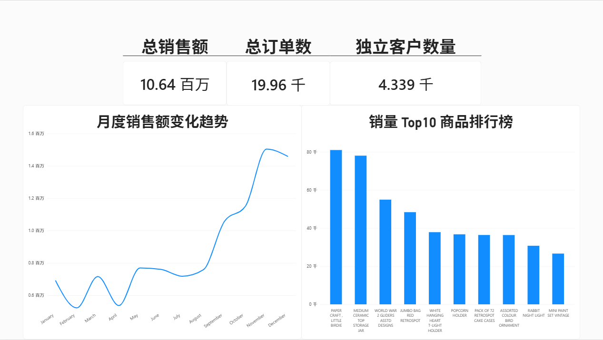

# 线上零售订单数据分析项目

> 基于 Kaggle Online Retail 数据集（541,909 行），使用 Python + SQLite + Power BI 完成从数据清洗到可视化看板的完整分析流程，聚焦**销售趋势**与**商品 ABC 分类**，为库存优化与备货计划提供数据支撑。

---

## 📌 项目背景

零售店铺面临两个核心问题：
1. **什么时候该备货？** —— 需要识别销售淡旺季
2. **哪些商品该重点管理？** —— 需要识别核心爆款与长尾商品

本项目通过分析 2010-2011 年线上零售订单数据，回答以上问题，并输出可落地的供应链建议。

---

## 🛠 技术栈

| 工具 | 用途 |
|:---|:---|
| Python (Pandas) | 数据清洗与预处理 |
| SQLite | 数据存储与业务查询 |
| Power BI | 可视化仪表盘搭建 |

---

## 🎯 分析目标

- **目标 A**：月度销售趋势分析，识别淡旺季规律，为备货计划提供依据
- **目标 B**：商品 ABC 分类，识别核心爆款与长尾商品，优化库存结构

---

## 📊 核心发现

### KPI 概览
- 总销售额：**10,642,110.8**
- 总订单量：**19,960**
- 独立客户数：**4,339**
- 平均客单价：**533.7**

### 关键结论
1. **销售旺季**：10、11、12 月为销售高峰（受圣诞季带动），2、3、4 月为淡季
2. **核心爆款**：销售额 Top 商品为 DOT、22423、23843，属于 A 类商品
3. **客户结构**：散客占比较高，客户沉淀与复购存在提升空间

---

### 🎯 RFM 客户细分

通过 RFM 模型对 4,339 名客户进行分层，结果如下：

| 客户分层 | 人数 | 贡献金额 | 人均贡献 |
|:---|:---|:---|:---|
| 重要价值客户 | 601 | 630.2 万 | 10,486 元/人 |
| 重要挽留客户 | 649 | 104.5 万 | 1,610 元/人 |
| 新客户 | 657 | 49.5 万 | 753 元/人 |
| 一般客户 | 2,432 | 280.0 万 | 1,151 元/人 |

**关键洞察**：
1. **重要价值客户仅占 13.9%，却贡献了 59.2% 的营收**——典型的二八定律，是店铺的核心资产。
2. **重要挽留客户共 649 人**，人均消费 1,610 元，但最近消费频次显著下降，属于**高价值流失客户**，是最需要挽留的群体。
3. 一般客户人数最多（56.1%），但人均贡献仅 1,151 元，属于长尾客户。

**供应链建议**：
1. **重要价值客户**：提供优先发货、专属客服，保障履约体验，避免核心客户流失。
2. **重要挽留客户**：在 7 天内推送定向优惠券，并在供应链上预留**小批量、高频次**的补货能力，快速响应召回订单。
3. **一般客户与新客户**：通过会员体系提升复购，评估**长尾客户履约成本**，避免物流成本高于利润。

## 💡 业务建议

- **备货策略**：9-10 月启动旺季备货，提前锁定供应商产能，增加安全库存
- **库存优化**：对 A 类商品建立安全库存预警机制，采用 JIT 补货；对 C 类长尾商品控制采购频次
- **客户运营**：针对高频复购客户优化配送时效，针对散客通过会员体系提升留存

---

## 📈 可视化看板



---

## 📁 项目结构
```
online-retail-analysis/
├── data/
│ └── cleaned_data.csv # 清洗后的数据
├── python/
│ └── data_cleaning.py # Python 清洗代码
├── sql/
│ └── analysis_queries.sql # SQL 查询语句
├── dashboard.png/ # 看板截图
├── report/
│ └── 项目报告.docx # 完整报告
└── README.md
```

---

## 🚀 复现步骤

1. 从 [Kaggle Online Retail Dataset](https://www.kaggle.com/datasets/vijayuv/onlineretail) 下载原始数据集
2. 运行 `python/data_cleaning.py` 完成数据清洗
3. 将 `cleaned_data.csv` 导入 SQLite，运行 `sql/analysis_queries.sql`
4. 用 Power BI 打开数据，参照 `powerbi/dashboard.png` 搭建看板

---

## 📝 项目收获

- 掌握完整数据分析流水线：数据清洗 → SQL 取数 → 业务分析 → 可视化看板
- 理解并实践 ABC 分类与月度趋势分析两大供应链核心方法
- 能够将数据结果转化为可落地的库存优化与备货策略建议

---

## 📮 联系方式

- GitHub: [1233cult](https://github.com/1233cult)
- Email: 3352837409@qq.com
